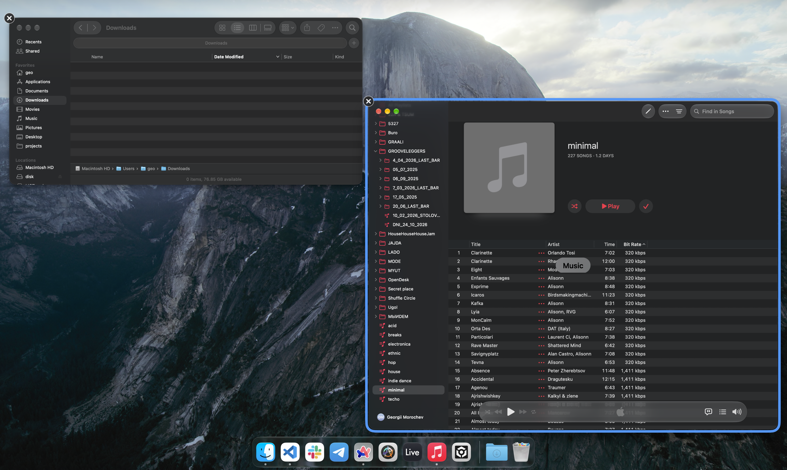
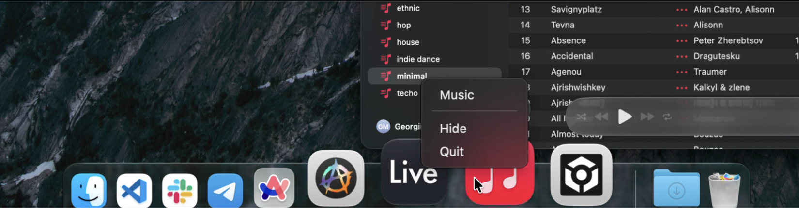
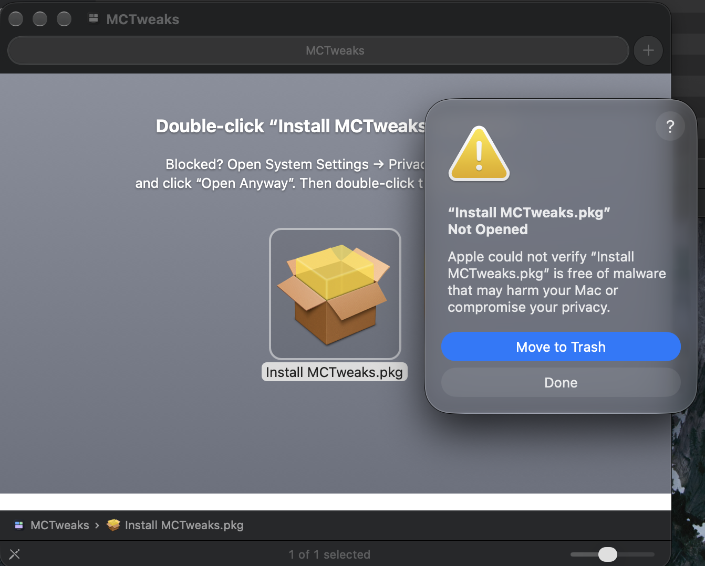
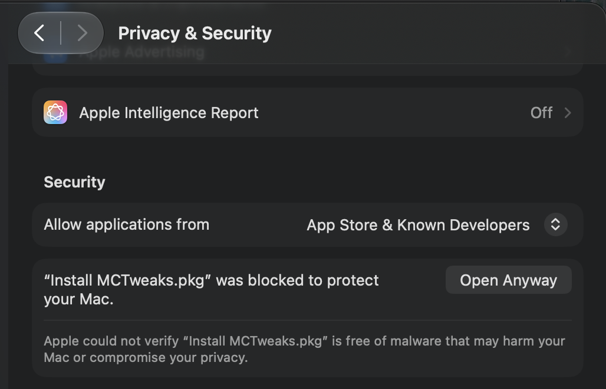
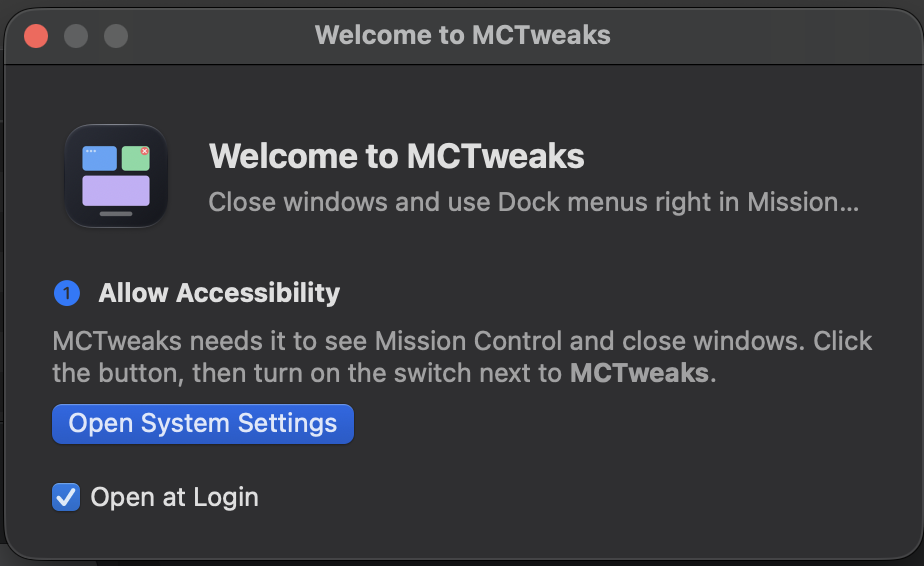
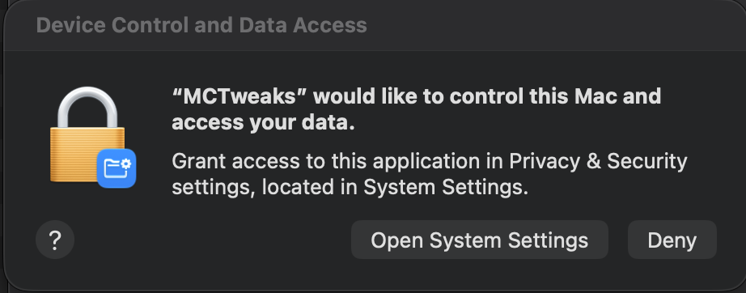
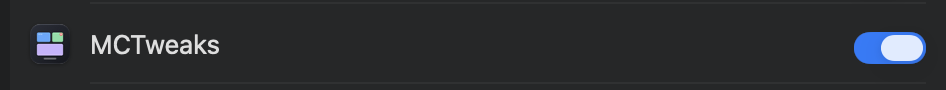

# MCTweaks

MCTweaks adds two things to **Mission Control** on macOS:

- a **×** button on every window: click it to close the window, **⌥ Option**-click to quit the whole app;
- a **menu on Dock icons**: right-click an icon while Mission Control is open (the Dock normally ignores right-clicks there).





**Requirements:** a Mac with Apple Silicon (M1 or newer) and **macOS 27**. Older macOS versions are not tested: they draw Mission Control differently, and MCTweaks may start but do nothing there.

---

## Install

MCTweaks is free and not signed by Apple, so macOS asks one extra question the first time. Follow these steps once; it takes about two minutes.

### 1. Download

On the [Releases](../../releases/latest) page, under **Assets**, click `MCTweaks-<version>.dmg`.

### 2. Run the installer

1. Double-click the downloaded `.dmg` file. A window with **Install MCTweaks** opens.
2. Double-click **Install MCTweaks**. macOS says it could not check it ("Not Opened"). This is expected for free apps not signed by Apple. Click **Done** (not Move to Trash).

   

3. Open **System Settings → Privacy & Security**. Scroll down to the message about "Install MCTweaks.pkg" and click **Open Anyway**. Confirm with your password or Touch ID.

   

4. The installer opens. Click **Continue**, then **Install**, and enter your Mac password. MCTweaks goes to **Applications**.
5. When the installer finishes, MCTweaks **starts by itself**. Close the installer (it may offer to move it to the Trash — that's fine) and eject the disk: right-click **MCTweaks** in the Finder sidebar → **Eject**.

### 3. Follow the Welcome window

MCTweaks opens a **Welcome** window that guides you through the rest:



1. Click **Open System Settings**. In the macOS dialog, click **Open System Settings** again.

   

2. Turn on the switch next to **MCTweaks**. (On macOS 27 the page is called **Device Control and Data Access**; on older versions **Accessibility**.)

   

3. Go back to the Welcome window: it shows a green ✓ by itself. **Open at Login** is on by default.
4. Click **Done**.

That's it. MCTweaks lives in the menu bar (icon with three small windows); there is no Dock icon.

---

## Use

Open Mission Control: press **F3** (Mission Control key), swipe up with three fingers, or press **⌃ Control + ↑**.

| Action | Result |
|---|---|
| Click **×** on a window | Closes that window (like its red button) |
| **⌥ Option** + click **×** | Quits the app of that window |
| Right-click a Dock icon | Menu: the app's windows, **Hide**, **Quit** |
| Right-click another Dock icon | Switches to that icon's menu |
| Hold **⌥ Option** and click **Quit** | Force quits the app |
| Right-click an app that is not running, a folder or Trash | Menu: **Open** |
| Click a window name in the menu | Brings that window to the front |
| Click anywhere else | Closes the menu |

The × buttons show only for windows on the current desktop.

### Menu bar

Click the MCTweaks icon in the menu bar:

- **MCTweaks is working** — or what needs your attention; click it to open the Welcome window.
- **Open at Login** — start MCTweaks when you log in.
- **How to Use…** — a short reminder of the table above.
- **Check for Updates…** — opens the latest release.
- **Quit MCTweaks**.

---

## Update

1. Menu bar icon → **Check for Updates…** → download the new `.dmg`.
2. Run the installer as in **Install**, step 2. It quits the old version, replaces it and starts the new one.
3. If the Welcome window asks for permission again, click **Open System Settings** and turn the switch on — the button removes the old entry for you.

## Uninstall

1. Menu bar icon → turn off **Open at Login**, then **Quit MCTweaks**.
2. Move **Applications → MCTweaks** to the Trash (Finder asks for your password: the installer put it there).
3. Optional: in **Privacy & Security → Device Control and Data Access** (or **Accessibility**), select MCTweaks and click **−**.
4. Optional, in Terminal — forget the installer record: `sudo pkgutil --forget dev.geo.mctweaks.pkg`

## Troubleshooting

| Problem | What to do |
|---|---|
| "Install MCTweaks.pkg Not Opened" / "Apple could not verify…" | Expected. **Privacy & Security → Open Anyway** (Install, step 2). |
| No "Open Anyway" button in Privacy & Security | It appears only after you try to open the installer once. Double-click **Install MCTweaks** again, click **Done**, then look again. |
| MCTweaks did not start after the installer | Open it from **Applications**. |
| The switch is on, but MCTweaks still asks for permission | Click **Open System Settings** in the Welcome window and turn the switch on again. |
| No × buttons in Mission Control | Check the menu bar icon: it says what is missing. |
| A click on × does nothing | Some apps do not let other apps close their windows. **⌥ Option**-click to quit the app instead. |
| Stopped working after a macOS update | MCTweaks reads undocumented Mission Control data; a new macOS can change it. Please open an issue. |

---

## For developers

```sh
swift test                 # unit tests (MCKit)
make build                 # build/MCTweaks.app
make install               # copy to ~/Applications and open it
make uninstall
make pkg                   # build/Install MCTweaks.pkg (installs to /Applications, then starts the app)
make dmg VERSION=1.2.3     # build/MCTweaks-1.2.3.dmg with the installer (installs pinned dmgbuild into build/venv)
make dmg-image             # only the DMG from an existing pkg
make icon                  # Resources/AppIcon.svg → Resources/AppIcon.icns
make dmg-background        # redraw Resources/dmg/background*.png
```

**CI:** every push to `main` and every pull request runs the tests and builds the DMG (download it from the run's artifacts).

**Release:** push a tag, for example `git tag v0.1.0 && git push origin v0.1.0`. GitHub Actions runs the tests, builds the DMG and publishes the release. The signing key is used only to sign the app and is removed before any third-party build tool runs; `dmgbuild` and its dependencies are installed from `Resources/dmg/requirements.txt` with pinned hashes.

**Signing:** without secrets, builds are ad-hoc signed, and users must allow Accessibility again after every update. To keep the permission across updates, create a free self-signed certificate once and add it to the repo secrets:

```sh
scripts/make-signing-cert.sh   # prints the gh secret commands to run
```

Keep `build/signing/` private and backed up: a new certificate makes every user allow Accessibility again. The certificate does not remove the "unverified developer" warnings; only an Apple Developer ID does.
